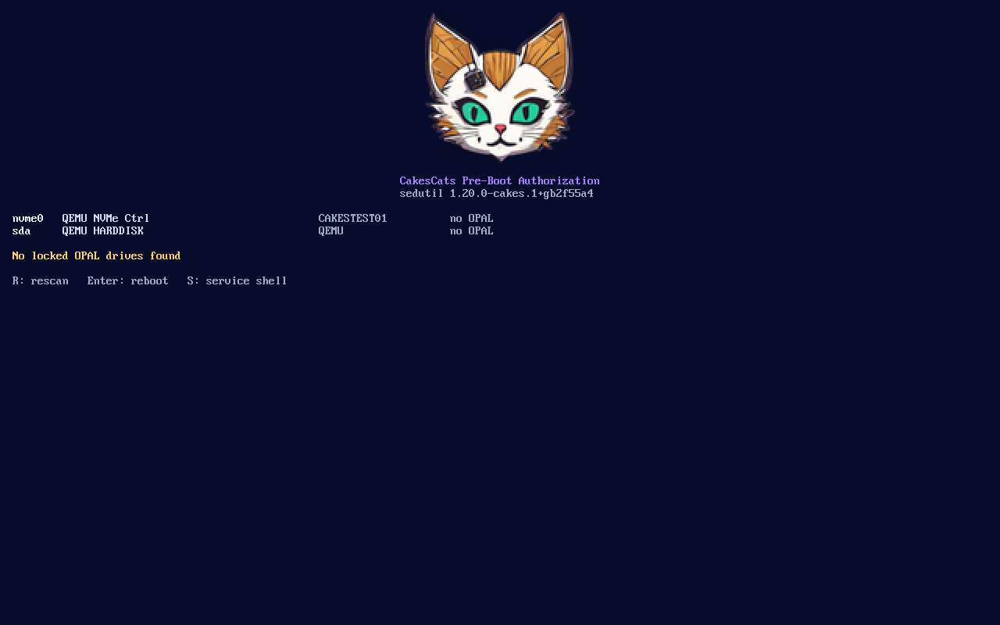

# CakesCats PBA: a maintained sedutil PBA for TCG OPAL 2.0 self-encrypting drives


A pre-boot authorization (PBA) image for **sedutil**, for SSDs with hardware
encryption (TCG OPAL 2.0 self-encrypting drives, SED). It boots from the drive's
shadow MBR, asks for the password, unlocks the drive and starts your OS.
It is a fork of [Drive-Trust-Alliance/sedutil](https://github.com/Drive-Trust-Alliance/sedutil).
The official PBA images were last released in 2021 (1.20) and often hang on
current laptops ([sedutil#404](https://github.com/Drive-Trust-Alliance/sedutil/issues/404)).

[Русский](README.ru.md)



## What is different from the DTA 1.20 PBA

| | DTA 1.20 PBA | CakesCats PBA |
|---|---|---|
| Base | Buildroot 2017.05, kernel 4.11 | Buildroot 2026.02 LTS, kernel 6.18 LTS |
| Build | prebuilt images, hand-patched forks | reproducible, GitHub Actions, published hashes |
| Several drives | one password, then an immediate reboot | each password is tried on every locked drive; after a 3 s window you can type another password for the rest |
| Partitions | the whole drive, one password | partitions can be locked with passwords of their own, typed one after the other ([docs/partitions.md](docs/partitions.md)) |
| Password hashing | PBKDF2-SHA1, 75000 iterations | the same by default, plus PBKDF2-SHA512 with configurable iterations |
| Service shell | hidden: type `debug`, root without a password | explicit: on, off, or behind its own password; off in the hardened image |
| Network | brought up at boot | off. Drivers are kept as modules for later features (hardened image: none) |
| Reboot into the OS | cold | warm by default, so the drive stays powered and unlocked |
| Hangs on new CPUs | edit `syslinux.cfg` by hand | boot menu entry with `nosmp` (press Esc at start) |
| Look | plain text | CakesCats logo and palette |

Your existing drives keep working. The default hashing is the same as in
sedutil 1.x, so you don't need to set the passwords again.

## Download

Every release has two images, each with a `.sha256` file:

- `cakes-pba-<version>-default.img.gz` is the one for most people.
- `cakes-pba-<version>-hardened.img.gz` has no service shell, no kernel modules and no network drivers.

## Install

You need `sedutil-cli`, either from this repository or the DTA 1.20 binaries.
Read the [DTA guide](https://github.com/Drive-Trust-Alliance/sedutil/wiki/Encrypting-your-drive) first.

1. Write down the PSID printed on the drive label. It is the only way back if
   the password is lost (`--PSIDrevert` erases the drive).
2. Test the image without touching the drive. Write it to a USB stick, boot
   from it and check that it shows your drives (`dd if=cakes-pba-...img of=/dev/sdX`).
3. Set up the drive and load the PBA:

   ```
   sedutil-cli --initialSetup <password> /dev/nvme0
   sedutil-cli --loadPBAimage <password> cakes-pba-<version>-default.img /dev/nvme0
   sedutil-cli --setMBREnable on <password> /dev/nvme0
   sedutil-cli --enableLockingRange 0 <password> /dev/nvme0
   ```

   For SHA-512 hashing, add `-H sha512` to every command. Then set
   `hash = sha512` in the image's config, or try both with `hash = sha512,sha1`.
4. Power off completely, then turn the machine on.

Several drives can each have their own password. The image only needs to be
on the drive the firmware boots from. Partitions can have their own password
too, see [docs/partitions.md](docs/partitions.md).

## Configuration

Settings live in `/etc/cakes-pba.conf` inside the image. Every key except the
service shell ones can also be set from the boot menu (`EFI/BOOT/grub.cfg` on
the image) as `cakes.<key>=<value>`. See [docs/configuration.md](docs/configuration.md).

## Sleep and hibernation

The PBA only runs at a cold boot. What happens on sleep depends on whether
the drive loses power, so test it on your machine:

- **Hibernate (S4) and Windows Fast Startup**: the machine boots through the
  PBA, you enter the password, and the OS resumes. This works.
- **S3 and Modern Standby**: the OS resumes without the PBA. If the drive kept
  power, everything works. If it lost power, it is locked again and the running
  OS cannot read it.

See [docs/sleep-matrix.md](docs/sleep-matrix.md) for the test plan and results.

## Build

On a Linux x86_64 host:

```
scripts/build.sh --profile default     # or hardened, --logo my.png
scripts/qemu-smoke.sh dist/cakes-pba-*-default.img
make -C tests/host check
```

Or use the `Dockerfile`. The image ends up in `dist/`.

## Roadmap

Planned: a builder for custom images, OPAL tools for Windows and Linux, PIN
and emergency erase, USB key files, a native UEFI PBA, and TPM and corporate
unlock. See [docs/roadmap.md](docs/roadmap.md).

## License

GPL-3.0-or-later, the same as sedutil. Copyright Bright Plaza Inc. (sedutil)
and CakesCats (changes). The SHA-512 code comes from cifra (CC0). The logo is © CakesCats.
